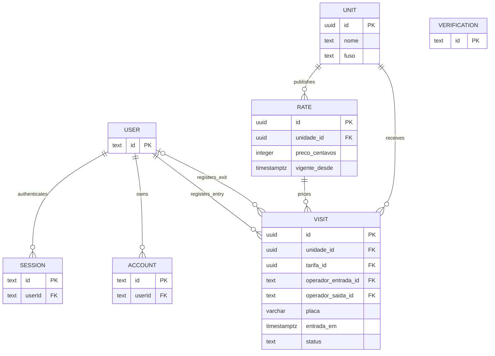

# Banco de dados

No PostgreSQL, as tabelas de domínio são `unidades`, `tarifas` e `visitas`. A chave estrangeira composta `(unidade_id, tarifa_id)` exige que a tarifa pertença à unidade da visita. O índice único parcial impede mais de uma visita aberta para a mesma placa na mesma unidade.
